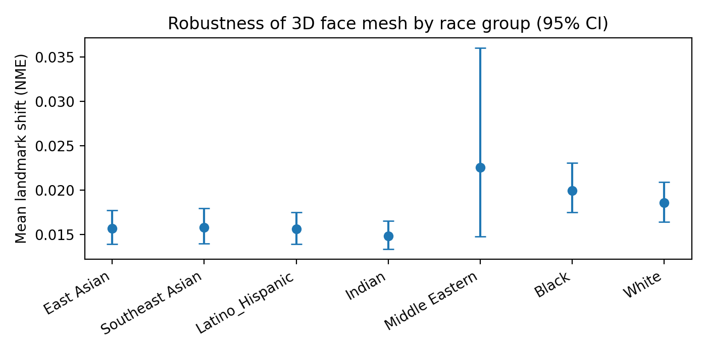
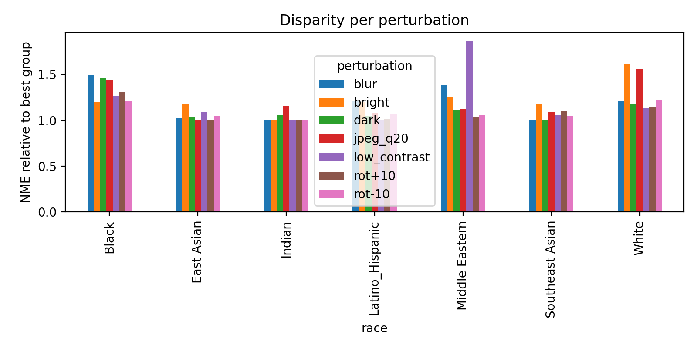

# Face3D-Fairness-Audit

**A preliminary audit of demographic disparities in single-image 3D face mesh estimation**

Pranay Sharma, Srishty Jain · 2026 · *Work in progress*

3D face reconstruction models are usually evaluated with one global average error. This hides whether a model works equally well for everyone. This project audits a widely used single-image 3D face model, **MediaPipe Face Landmarker** (478 3D landmarks), across **race, sex and age** groups, with a focus on facial measurements used in the diagnosis of **foetal alcohol spectrum disorder (FASD)**.

## What we measure

No 3D ground truth is needed:

1. **Failure rate:** how often no face mesh is produced, per group.
2. **Robustness (NME):** how far the 3D mesh moves when the same photo is made darker, brighter, low-contrast, blurred, JPEG-compressed or rotated by ±10°, normalised by inter-ocular distance.
3. **FASD-relevant measurement stability:** relative change in palpebral fissure length, philtrum length and upper-lip thickness under the same perturbations.

Statistics: bootstrap 95% confidence intervals (1,000 resamples), Kruskal–Wallis tests across groups, and Mann–Whitney tests against the best group with Holm correction.

## Data

**FairFace** validation split, 300 images per race group × 7 groups = **2,100 images** (images upscaled ×2 from 224 px).

## Key results

| Race group | Failure rate | NME median | NME mean [95% CI] | Philtrum instability vs best |
|---|---|---|---|---|
| Southeast Asian | 8.3% | 0.0111 | 0.0158 [0.0140, 0.0179] | 1.08× |
| East Asian | 14.7% | 0.0106 | 0.0157 [0.0139, 0.0177] | 1.00× |
| Black | 18.0% | 0.0129 | 0.0199 [0.0175, 0.0230] | 1.36× |
| Indian | 19.0% | 0.0115 | 0.0148 [0.0133, 0.0165] | 1.01× |
| Latino/Hispanic | 19.0% | 0.0115 | 0.0156 [0.0139, 0.0175] | 0.99× |
| Middle Eastern | 20.3% | 0.0121 | 0.0225 [0.0148, 0.0360] | 1.17× |
| White | 21.3% | 0.0132 | 0.0186 [0.0164, 0.0209] | 1.06× |

- **Failure rates differ by race** (8.3% to 21.3%, χ² p = 0.0003), by sex (female 14.4%, male 19.8%, p = 0.002) and by age (12.1% for 0–19 to 21.5% for 40–59, p = 0.002).
- **Age has the largest effect on robustness:** mean NME is **1.59×** higher for faces aged 60+ than for 0–19 (Holm p < 10⁻⁵).
- **Robustness differs by race** (Kruskal–Wallis p = 0.0002). Black and White faces show significantly higher landmark shift than East Asian faces (Holm p ≈ 0.007 and 0.006). Indian faces were among the most stable.
- **FASD-relevant measurements:** philtrum length is **1.36×** less stable for Black faces (Holm p < 10⁻⁸), and upper-lip thickness 1.19× (p = 0.003). Palpebral fissure length is 1.40× less stable across age groups (p < 10⁻⁶).




## Limitations

- **No 3D ground truth:** we measure reliability and robustness, not reconstruction accuracy.
- **One model and one dataset.** Results may differ for other 3D face models (e.g. DECA, 3DDFA-V2).
- **Confounders not yet controlled:** failures may partly reflect head pose, crop or image quality rather than demographics.
- FairFace labels are perceived attributes assigned by annotators, not self-identified.

## Next steps

Add more 3D face models, control for pose and image quality, and evaluate accuracy on a dataset with 3D ground truth.

## How to run

Open `Face3D_Fairness_Audit.ipynb` in Google Colab and select **Runtime → Run all** (about 10–20 minutes on CPU). Results are written to `results/`.

## Repository

```
Face3D_Fairness_Audit.ipynb   # full pipeline
results/                       # CSV tables, figures, summary.json
requirements.txt
```
